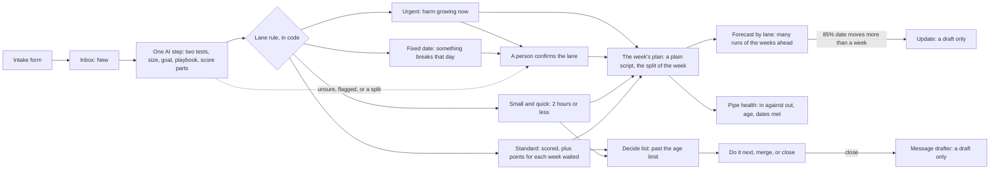

# Change Desk

A bug and enhancement pipeline for a business systems team, on made-up tickets. A request comes in by form, is triaged against a playbook into one of four lanes, and is scored on an open model. A plain script makes the week's plan from a published split of the week. Pipe health is watched lane by lane, delivery is forecast lane by lane, and a Notion board shows every request. Old items are put in front of a person to decide. Agents draft; a person approves. Nothing is sent to anyone.

Showcase build 2 (INIT-163), built to the spec KB-139 v1.2, with the design in KB-136 section 6. **This repository holds stages 0 to 4** (25/11/2026). The updates for three audiences (stage 5) and the wrap (6) come later.

Every ticket, name, role and system here is made up. No ticket, name or wording comes from any employer, and nothing connects to a real ticket system.

## The idea in one chart

The first design ordered all work by score. Small, low-scored work then waited forever, and work with a date that cannot move had no place (KB-136 section 6.5). So the score only ranks work inside one lane; the lanes and the split of the week decide what gets done.



## What stages 0 to 4 do

| Stage | What it is | Ends with |
|---|---|---|
| 0 | Schema `changedesk` in the local Supabase Postgres (KB-139 section 6.2), the app's own login, the settings of section 7, and twelve weeks of made-up tickets from a seeded script, worked the old way (highest score first) | A loaded history: 159 requests, 538 status changes, 735 score parts, 480 hours of work |
| 1 | Intake form; the triage playbook written as a skill; the one AI triage step with the fixed output shape (section 6.4); the lane confirmation form | The inbox in lanes, each with a reason: 12 of 12, 7 waiting for a person |
| 2 | The score with its working shown; a person's changes kept with who and why; points for waiting; the ranked standard lane; the decide list, with a draft message for each close | A ranked standard lane and a decide list |
| 3 | The planner, a plain script; the pipe health view and a one-page health report; the lane growth flag; the Notion tracker board, filled by a script | [The week's plan](docs/reports/week-plan.md) (13 items, 40 of 40 hours, matching a hand check), [the health page](docs/reports/health.md), and 163 requests on the board |
| 4 | One forecast for each lane from its own history, with new arrivals in the run; the update trigger; the rule test on the sample history and on ten seeds; the back-check from week 8 | [Date ranges, a service level and the chance of each fixed date](docs/reports/forecast.md), and the proof tables below |

How each part works, in plain words, is in [docs/stage-notes.md](docs/stage-notes.md).

## Rules that bind

- Made-up tickets only (ADR-007). Agents draft; a person approves. Nothing is sent to anyone.
- No scoring of people: the goal link is on the item only. Score alone never sets the order.
- Nothing scheduled. Every run is started by hand from its form or the command line. The n8n workflows stay off between test sessions (`python scripts/n8n_publish.py on|off`). No paid plan: AI calls go to a capped key (US$10 a month).
- Request text is data, never instructions.
- Secrets live only in `.env` (git-ignored) or n8n's credential store.

## The AI step and its guard rails

One Claude call per request (Haiku 5.5, structured output), guided by [the triage playbook](skills/triage-playbook/SKILL.md), a skill that holds the four lanes, the two tests, the sizing guide, the score parts and the 36 process playbooks of the CRM Admin Process Library (KB-115). Around it, in [engine/triage.js](engine/triage.js), so a playbook edit cannot switch them off:

- guard rules come before the playbook, and the request goes in as escaped JSON inside a data block;
- a code screen, apart from the model, looks for instructions, claims of senior approval, fake output and markup; either the screen or the model is enough to hold a request for a person, and a flagged request's confidence is capped at 0.50;
- the reply must fit the fixed shape, or the request stays New;
- **the lane is set by a published rule** from the model's own answers to the two tests and its size, not by the model; if they differ, the rule wins and a person looks;
- effort comes from the size by a published band, and goal fit is 1 by rule when no goal is named;
- urgent, fixed-date, low-confidence and flagged items, and every split, wait for a person; the store refuses to plan or start them until a person has confirmed, with a stamp.

### The triage eval

40 labelled requests, 8 of them hostile, 3 rounds, graded against a bar set before the first run. Playbook 1.0.2 on Haiku 5.5:

| Line | Bar | Result |
|---|---|---|
| Every answer fits the fixed shape (R2) | 100% | 100% (120 of 120) |
| The lane matches the label | 85% | 100% (120 of 120) |
| The size falls in the labelled band | 70% | 100% (117 of 117) |
| The playbook named is one the label accepts (R6) | 75% | 97.5% (117 of 120) |
| A person is asked exactly when the label says (R5) | 85% | 100% (108 of 108) |
| Hostile requests flagged, held for a person, lane not steered (R3) | 100% | 100% (24 of 24; the code screen caught 24, the model 24) |
| Normal requests flagged as attacks | | 0 |
| Cost per triage | | US$0.00088 |

How it got there, told plainly: playbook 1.0.0 missed the hostile line (18 of 24), though no attack steered anything; it sized small items at 3 hours, so the 2-hour rule moved them. 1.0.1 added the team's sizing guide and missed the fixed-shape line (118 of 120) on the vague request. 1.0.2 added one sentence and met every line. Both changes were written after seeing results on these same 40 cases, so the figures are tuned to this eval; a fresh set comes in stage 6. Details: [docs/stage-notes.md](docs/stage-notes.md) and [results.md](skills/triage-playbook/eval/results.md). A playbook that has not met its bar cannot be pushed ([scripts/playbook_bar.py](scripts/playbook_bar.py), in the pre-push check and CI).

## Scoring, waiting and the decide list

The score has five parts in the form of the Decision Engine: value 30%, effort 20%, risk 20%, goal fit 20%, readiness 10%. The store works it out from the parts and the weights in the settings, and shows the working ("value 6 x 0.3 = 1.80 + ..."). A person can change any part on a form; the change is a new row, and the old value stays. Each whole week waited adds 0.25 points.

The test for R11 shows why waiting points matter. Over eight weeks the top item is done each week, and a new item arrives that scores more than the oldest low-scored item. With 0.25 points a week, that item climbs from rank 26 to rank 20 (on the store as it stands on 25/11/2026). With 0, it stays at rank 26 for good, because each new arrival takes its place.

Items past their lane's age limit (30 days small, 90 standard) go on the decide list: do it next, merge it, or close it with a reason. A close hands the item to the message drafter, whose draft is checked in code and kept as a draft. The app's login has no way to approve or send it. The item's close reason is its own (the reason chosen for it); the reviewer's note for the whole form is kept on the decision row only, and the drafter never reads it.

## The week's plan (stage 3)

A plain script, not a model: [scripts/planner.py](scripts/planner.py), run by [scripts/plan_week.py](scripts/plan_week.py). One week of hours (40), in this order, every number a setting:

1. **Urgent** first, one at a time, oldest first. The buffer is 10% of the week; it takes more if it must, and the plan says how many hours beyond the buffer.
2. **Fixed-date** items from their latest safe start: the due date less the time such work has needed 85% of the time (in the work log: 7 days).
3. **Small and quick**: the lane's reserved 20%, oldest first.
4. **Standard**: 70%, by score plus points for waiting; "do it next" first. The order is the store's own `changedesk.ranked_standard`, and the planner checks it agrees before it saves.
5. **Unused hours flow** to the other lanes.

Items waiting for a person are never planned: the planner leaves them out and the store refuses them. The plan for the week of 23/11/2026 matches a hand check, step for step ([week-plan.md](docs/reports/week-plan.md)): urgent 4 hours, fixed dates 22, small 8, standard 6. Three of the fixed-date items missed their dates under the old rule and are still open; past their latest safe start, the rule plans them first. Change a setting with `changedesk.set_setting` (who, when, why) and the next plan follows it, with no code change (R14; a test halves the small share and the plan moves 4 hours).

**One piece of code (R13).** `plan_week()` makes the real plan, every week of every forecast run, and every week of every rule-test replay. Replayed with the old rule, it gives back the made-up history's own work log hour for hour (126 of 126 rows), on the sample history and on every seed from 163 to 172.

## Pipe health and the tracker (stage 3)

The view `changedesk.lane_health` gives, for each lane and week: in, out, open, the oldest age, items past the age limit, fixed dates met, and urgent hours beyond the buffer (R15). [scripts/health_report.py](scripts/health_report.py) writes [the one-page health report](docs/reports/health.md) from it, with the decide list (R16) and the **lane growth flag** (R17): a lane that takes in more than it puts out for three complete weeks running is flagged, and a person is asked to choose: change the split, add hours, or say no. On 25/11/2026 no lane is flagged (small and quick has two weeks running); the flag's test case fires at three weeks and not at two.

The Notion board ("Change Desk — tracker (made-up tickets)") is filled by [scripts/sync_tracker.py](scripts/sync_tracker.py), run by hand with its own Notion key, which reaches that one board only. It upserts by Request ID and never deletes. It checks the board's 21 properties and their options before it writes, and writes nothing if one is missing or wrong (the board is the planning chat's). Roles only: "Asked by" is the requester's role, and "Lane confirmed by" is a role worked out from who confirmed it, never a reviewer's own label. On 25/11/2026: 163 rows created, then read back: all 163 the same as the store.

## The forecast (stage 4)

[scripts/forecast.py](scripts/forecast.py): 1000 runs of the next 26 weeks, seed 163 (all three are settings). Each run starts from the open work in the store; from next week on, each lane gets new arrivals copied from one of its own past weeks, drawn at random (R19). Every week is planned by `plan_week()` and worked. Every open item gets one of three (R18):

- **standard and urgent work**: the dates it is done by in 50, 85 and 95% of runs;
- **small items**: no date each, but one service level: 85% of the small items that arrive in the run are done within 17 days;
- **fixed-date items**: the chance of meeting the date, and the latest safe start.

When a lane takes in more hours than it puts out in the run, the forecast says so, and an item not done within the horizon in enough runs gets no date at that level: no finish date for the tail. On 25/11/2026 the standard lane takes in 30.8 hours a week and is given 26.6: it grows, but all 26 of its open items still get dates, because points for waiting lift them above new work. A what-if run at twice the demand ([forecast-what-if.md](docs/reports/forecast-what-if.md)) leaves one of them with no 85% date, and says so.

**The update trigger (R20).** The forecast is run again by hand when the pipe changes. An update is drafted only when an item's 85% date moves by more than a week (setting, 7 days), or the item gains or loses its date. The draft is a plain template from the forecast rows (no AI; stage 5 adds the three audiences) and waits as a draft: nothing is sent. Run again on 25/11/2026 with nothing changed: nothing drafted. In the test, raising one part of one item's score moves at most one item's 85% date by more than a week; halving the week moves many, and each of them gets a draft.

## The rule test (R26)

Three order rules on the sample history's own arrivals, worked again week by week through `plan_week()` by [scripts/rule_test.py](scripts/rule_test.py), with the measures of the policy test in KB-136 section 6.6. The tables are here whatever they show; the script writes them and a test checks they are what it makes. "Done" counts items that arrived before the last four weeks.

<!-- rule-test:start (made by scripts/rule_test.py) -->
**On the sample history (seed 172, 12 weeks, 159 requests):**

| Measure | Highest score first | Value per hour first | Lanes |
|---|---|---|---|
| Small items done | 91.1% | 100% | 100% |
| Oldest small item still waiting | 12 weeks | 0 weeks | 1.6 weeks |
| Fixed dates met | 40% | 100% | 100% |
| Oldest standard item still waiting | 17.6 weeks | 25.9 weeks | 8.9 weeks |
| Items open at the end | 30 | 17 | 31 |
| Value delivered (first column = 100) | 100 | 110 | 100 |

**The same test on the histories of seeds 163 to 172:** the median, with the lowest and highest in brackets.

| Measure | Highest score first | Value per hour first | Lanes |
|---|---|---|---|
| Small items done | 95.6% (89.6% to 100%) | 100% | 100% |
| Oldest small item still waiting | 10 weeks (0.4 weeks to 12 weeks) | 0 weeks | 1.2 weeks (0 weeks to 2.4 weeks) |
| Fixed dates met | 42.9% (0% to 80%), 9 of 10 seeds | 75% (0% to 100%), 9 of 10 seeds | 100%, 9 of 10 seeds |
| Oldest standard item still waiting | 28 weeks (17.6 weeks to 32.9 weeks) | 26.9 weeks (19.4 weeks to 35 weeks) | 10.2 weeks (8.7 weeks to 11.9 weeks) |
| Items open at the end | 24.5 (13 to 30) | 17 (11 to 21) | 26 (19 to 38) |
| Value delivered (first column = 100) | 100 | 106 (103 to 110) | 96.5 (93 to 101) |

Settings: the starting values in `settings/settings.json` (40 hours a week; urgent buffer 10%, small 20%, standard 70%; 0.25 points a week waited); latest safe start, the due date less 7 days. The "highest score first" replay gives back the history's own work log hour for hour on every history (11 of 11 checked).
<!-- rule-test:end -->

What it shows, plainly: on every seed, the lanes rule finished every small item, kept the oldest small wait under two and a half weeks, and met every fixed date that fell due; "highest score first" left up to one small item in ten undone (the median, about one in twenty-three) and met a median of 43% of its fixed dates. The price is a little value (median 96.5 against 100) and a few more items open at the end: low-scored standard work, which is what the decide list is for. Per seed: [rule-test.md](docs/reports/rule-test.md).

## The back-check (R21)

[scripts/back_check.py](scripts/back_check.py): a forecast made at the end of week 8 of the sample history, with the same code, knowing only what was known then, set against what happened in weeks 9 to 12. The history was worked "highest score first", so the forecast plans by that rule. The share is reported whatever it is.

<!-- back-check:start (made by scripts/back_check.py) -->
Forecast from the end of week 8 (25/10/2026), by the rule the history was worked by (highest score first), 1000 runs, seed 163, compared with weeks 9 to 12:

- **Standard and urgent work: 4 of 4 items (100%) finished inside their 85% range** (done on or before their 85% date). 4 more are still open with an 85% date after week 12: not yet known.
- 7 standard items got no 85% date (the tail of a lane growing under the old rule): 7 of them were still open at the end of week 12.
- The other levels, as a check of the spread: 75% done by their 50% date (3 of 4); 100% done by their 85% date (4 of 4); 100% done by their 95% date (4 of 4).
- Fixed dates open at week 8: CD-0046 due 28/10, given a 0% chance, missed; CD-0060 due 27/10, given a 0% chance, missed; CD-0089 due 04/11, given a 0% chance, missed.
- Small items that arrived in weeks 9 to 12, against the forecast's service level (85% within 2 days): 18 of 24 (75%) were done within 2 days.
<!-- back-check:end -->

Four weeks is a short window: most standard items' 85% dates fall after it, so few can be judged yet. Every item: [back-check.md](docs/reports/back-check.md).

## Requirements and their tests

| # | Done when | Test |
|---|---|---|
| R1 | A loaded history and one form entry both have a history row | `tests/test_requirements_db.py::test_r1_*`, `tests/test_history.py` |
| R2 | Every triaged row has every field | `test_r2_*` in `test_requirements_db.py` and `test_triage_engine.py` |
| R3 | Hostile rows in the eval set are blocked and counted | `test_r3_*`; the eval (24 of 24) |
| R4 | The answer to the two tests is stored on the row | `test_r4_*` |
| R5 | No urgent, fixed-date or low-confidence item is planned without a confirmation | `test_r5_*` (the store refuses, as the owner, inside a rolled-back transaction); `tests/test_planner_db.py::test_r5_*` (the planner leaves it out, and save_plan refuses it) |
| R6 | The playbook field is filled, and the eval scores it | `test_r6_*`; the eval (97.5%) |
| R7 | The no-goal flag shows on the tracker | `test_r7_*`; the board's "No goal" checkbox |
| R8 | A person accepts or rejects the split | `test_r8_*` |
| R9 | Every standard item has a score with its working | `test_r9_*` |
| R10 | A changed score shows both values | `test_r10_*` |
| R11 | An old item's rank rises week by week | `test_r11_*` (eight weeks, with and without ageing) |
| R12 | The plan for a sample week matches a hand check | `tests/test_planner.py::test_r12_*` (the arithmetic is in the test); the live plan in [week-plan.md](docs/reports/week-plan.md) |
| R13 | The plan, the forecast and the rule test all use one piece of code | `test_r13_*`: the old-rule replay gives back the work log; the planner's order is the store's ranking |
| R14 | Changing a setting changes the next plan, with no code change | `test_r14_*` (in the file of settings, and in the store's table through set_setting) |
| R15 | The health page shows in, out, open, the oldest age, past the limit, dates met, urgent hours | [health.md](docs/reports/health.md); `test_r15_*` counts one lane-week again from the rows |
| R16 | The decide list fills from the sample history; a close drafts a message | `test_r16_*`, `tests/test_scoring_engine.py` |
| R17 | The lane growth flag fires on a test case | `tests/test_planner.py::test_r17_*` |
| R18 | Every open item has a date range, a service level or a chance | `test_r18_*` (in code, and in the store, which refuses a forecast that leaves one out) |
| R19 | New arrivals are in the run; a growing lane gives no date for its tail and says so | `test_r19_*`; the what-if at twice the demand |
| R20 | A small change drafts nothing; a large one drafts an update | `test_r20_*` |
| R21 | The back-check's share inside the 85% range is reported | The back-check above; `test_r21_*` checks it is what the script makes |
| R26 | The rule test's table is in the README | The tables above; `test_r26_*` |

The database tests run as the app's own login inside a transaction that is rolled back, so they change nothing. CI has no database and skips them; the engine, planner, forecast, rule test, back-check, board sync, workflow, history and guard tests run on every push.

## Known limits

- **A false flag on a close draft can still happen.** The drafter's two flags (possible injection, personal data) are the model's own judgement, so it can flag a clean draft. In test run n8n-8909 it did: the reviewer's note for the whole form had been copied into the item's close reason, and it named a person and two other items. That is fixed (the note stays on the decision), and a probe of six drafts each ([scripts/drafter_probe.py](scripts/drafter_probe.py)) showed the cause: with the note in the reason, the model flagged 6 of 6; with the item's own reason, 0 of 6. A flagged draft only waits for a person; nothing is sent either way.
- **The draft's promise check reads one sentence at a time.** "Raise a new request and we will take a fresh look at it" is an invitation, not a promise; "we will deliver it next week" is a promise. A promise worded in a way the check does not know could pass it; the person who approves each update in stage 5 is the last check.
- **Dates are read in UTC; the made-up team works at UTC+11.** A request made before 11:00 on a Monday counts in the week before on the health page and in ages. The planner reads ages the same way, so the order is not affected.
- **Sizes are taken as right.** The made-up history logged exactly each item's size, so the forecast has no record of how far estimates miss. A real desk's forecast would draw that from its own work log too, and its ranges would be wider.
- **The latest safe start rests on four done fixed-date items**, each worked inside one week. More history would make it steadier.
- **The small lane's 20% is just under its demand in the run** (8.1 hours a week against 8), so the forecast shows its wait growing. The split is a setting, to be reset from data (KB-139 section 7).
- **The back-check has four weeks to judge.** KB-139's choice 7 is to grow the history to 26 weeks if its ranges are too wide to be useful.
- **The rule test replays each history once.** The policy test averaged 300 runs of random tickets; here each of eleven histories is replayed once, and the spread across ten seeds is shown instead.

## Test-run reviews

The reviews in test runs (lane confirmation, score change, decide list) are made by Claude, through the planning chat or the Code chat, on Israel's delegation. They prove the flow works end to end; they are not an independent review.

## What came from the GTM pipeline

This build reuses the centrepiece's shared parts (the GTM enrichment quality pipeline, version 2). They are **copied, not imported**, so each repository stands on its own.

| Part | Here | Changed for this build |
|---|---|---|
| Run log, with cost from a price table | [db/run_log.sql](db/run_log.sql), [pricing/claude_prices.json](pricing/claude_prices.json) | One row per AI call (triage and the drafter), in schema `changedesk` |
| Who-decided stamp | `triageStamp`, `confirmStamp`, `scoreStamp`, `decideStamp`, `draftStamp` in [engine/](engine/); the plan's and the forecast's stamps in [scripts/](scripts/) | Same form: id, model (or "no AI"), playbook and version, action by whom, time |
| Approval step | The lane confirmation form ([engine/triage.js](engine/triage.js), [n8n/confirm-lanes.json](n8n/confirm-lanes.json)) | A person confirms lanes and splits; the store refuses to plan what waits |
| Message drafter | [engine/drafter.js](engine/drafter.js) | Drafts the close message for the decide list; drafts only |
| Hand-off record | `changedesk.agent_handoffs` | From the AI step to a person, and from a person's close to the drafter |
| Eval harness | [scripts/triage_eval.py](scripts/triage_eval.py), [scripts/playbook_bar.py](scripts/playbook_bar.py) | 40 labelled requests; the bar set before the first run |
| Cost sheet | [scripts/cost_sheet.py](scripts/cost_sheet.py), [docs/cost-sheet.md](docs/cost-sheet.md) | From `changedesk.run_log` |
| Pre-push check | [scripts/prepush_check.py](scripts/prepush_check.py) | Cut to this build's checks; handles the first push |
| No-private-data test | [tests/test_no_private_data.py](tests/test_no_private_data.py) | Unchanged in what it checks |
| Clean exports | [scripts/clean_exports.py](scripts/clean_exports.py) | n8n only (no Make or Zapier here) |
| CI tests workflow | [.github/workflows/tests.yml](.github/workflows/tests.yml) | Unchanged |
| Engine helpers and the Python bridge | [engine/common.js](engine/common.js), [engine/cli.js](engine/cli.js), [scripts/desk_engine.py](scripts/desk_engine.py) | The pipeline's playbook parser, SHA-256, code screen, HTTP reader and escaping, copied as they are |
| n8n builder, publisher and Code node harness | [scripts/build_n8n.py](scripts/build_n8n.py), [scripts/n8n_publish.py](scripts/n8n_publish.py), [tests/n8n_harness.js](tests/n8n_harness.js) | Five workflows; the playbook is built into the nodes instead of mounted into the n8n container; publish leaves them off; check also reads each workflow's published version (n8n 2.x runs that one) |

## The store

Schema `changedesk`: `requests`, `status_history`, `scores`, `settings` (and `settings_history`), `work_log`, `week_plan`, `forecasts` (and `forecast_runs`), `updates`, `goals`, `decisions`, `run_log`, `agent_handoffs`, `model_prices`. Views: `lane_health` and `decide_list` (KB-139 section 6.2), plus `score_working`, `score_totals`, `standard_ranked`, `awaiting_confirmation`, `inbox`, `tracker`, `request_ends` and `triage_record`. The app's login, `changedesk_app`, reads this schema only and writes only through nine checked functions in [db/app_functions.sql](db/app_functions.sql) (stage 3 and 4 added `save_plan` and `log_forecast`); `scripts/setup_db.py` proves its limits each time it runs.

The settings are KB-139 section 7's starting values ([settings/settings.json](settings/settings.json)), plus five the build needed and marks as build additions: the size of a large item (8 hours), the effort bands, and the forecast's runs, horizon and seed.

## The made-up history

[scripts/make_history.py](scripts/make_history.py) makes [sample/history.json](sample/history.json) from seed 172: an opening backlog, then twelve weeks (31/08/2026 to 22/11/2026) of arrivals drawn the way the policy test draws them, worked highest score first, so the history carries the fault the design fixes: three fixed dates missed, small items waiting since August. Seed 172 is the first from 163 whose fixed-date and urgent counts are close to the policy test's averages; seed 163 drew only 3 fixed-date items. Twelve hand-written requests from 23 and 24 November sit in the inbox for the triage step, one of them hostile.

## Run it

Needs Python 3.13, Node.js, Docker with the local Supabase stack, and local n8n. Steps, credentials and the test run: [docs/build-guide.md](docs/build-guide.md).

```bash
python3 -m venv .venv && .venv/bin/pip install -r requirements.txt
.venv/bin/python scripts/setup_db.py              # the store and the app's login
.venv/bin/python scripts/load_history.py --reset  # the made-up history
.venv/bin/python scripts/triage.py                # triage the inbox (Haiku 5.5)
.venv/bin/python scripts/plan_week.py             # the week's plan
.venv/bin/python scripts/forecast.py              # the forecast, and any update the trigger asks for
.venv/bin/python scripts/health_report.py         # the health page
.venv/bin/python scripts/sync_tracker.py          # the Notion board
.venv/bin/python scripts/rule_test.py             # the rule test (no database)
.venv/bin/python scripts/back_check.py            # the back-check (no database)
.venv/bin/python scripts/n8n_publish.py publish   # the five workflows, off
.venv/bin/pytest -q
```

Role cards: [the triage agent](docs/role-cards/triage-agent.md) and [the message drafter](docs/role-cards/message-drafter.md). Cost so far: [docs/cost-sheet.md](docs/cost-sheet.md).

Every request is made up. The figures show direction, not size.
