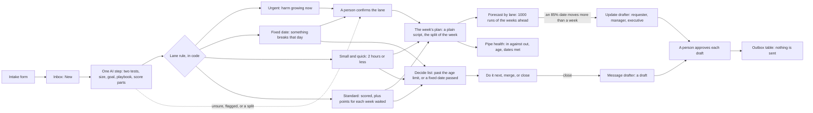
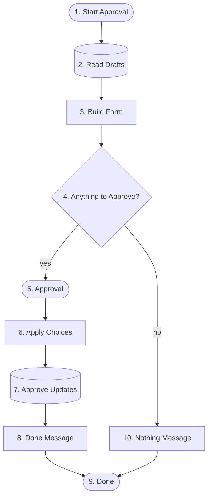

# Change Desk

A bug and enhancement pipeline for a business systems team, on made-up tickets. A request comes in by form. One AI step triages it against a playbook, and a published rule in code puts it in one of four lanes. A plain script makes the week's plan from a published split of the week. Pipe health is watched lane by lane, and delivery is forecast lane by lane. When a forecast date moves by more than a week, updates are drafted for three readers: the requester, the desk manager and the executive. A person approves each one. Agents draft; a person approves. Nothing is sent to anyone.

A showcase build, made to a written build spec, with the design and the reasons for it in a separate design note. **All seven stages, 0 to 6, are built**, and the whole flow was tested end to end on 25/11/2026. The repository is public.

Every ticket, name, role and system here is made up. No ticket, name or wording comes from any employer, and nothing connects to a real ticket system.

## The fault in the first design, and the test that showed it

The first design ordered every request by its overall score. The build's owner saw two faults (23/11/2026): small, low-scored work might never be done, and work with a date that cannot move had no place. A test on made-up tickets proved both (in the design note): half a year of tickets, 300 runs, demand of 42.7 hours a week against 40.

| Measure | Highest score first | Value per hour first | Lanes (this design) |
|---|---|---|---|
| Small items done | 83% | 100% | 100% |
| Oldest small item still waiting | 15.6 weeks | 0 | 0.4 weeks |
| Fixed dates met | 75% | 86% | 100% |
| Oldest standard item still waiting | 9.9 weeks | 14.1 weeks | 6.4 weeks |
| Items open at the end | 40 | 10 | 16 |
| Value delivered (first column = 100) | 100 | 107 | 104 |

So the score now ranks work only inside one lane. The lanes and the split of the week decide what gets done:

| Lane | What goes in | Order inside the lane | Its share of the week | What the requester is told |
|---|---|---|---|---|
| Urgent | Broken now, and the harm grows by the hour | At once, one at a time | A buffer of 10%; it takes more if it must | Started now, with a date range |
| Fixed date | A date that cannot move, and something breaks on it | From its latest safe start | First call on the hours once it is due to start | The chance of the date, and the last safe day to start |
| Small and quick | Two hours or less | Oldest first | A reserved share (22.5% since 25/11/2026) | A service level: 85% are done within so many days |
| Standard | Everything else | Score plus points for each week waited | The rest (67.5%) | A date range at 50, 85 and 95% |

The same test runs here on this build's own made-up history, through this build's planner: the rule test below.

## How a request moves through the desk



That chart is drawn by hand, to explain the idea. The six n8n workflows are drawn from their own files by `scripts/build_docs.py` ([docs/workflows.md](docs/workflows.md)); a test fails if a drawing differs from its file (R28):

<!-- generated:workflows start (made by scripts/build_docs.py) -->
| Workflow | Form | Nodes | AI steps | Writes through |
|---|---|---|---|---|
| Change Desk: intake form | `/form/changedesk-intake` | 5 | 0 | `add_request` |
| Change Desk: run triage | `/form/changedesk-triage` | 16 | 1 | `log_triage` |
| Change Desk: confirm lanes | `/form/changedesk-confirm-lanes` | 10 | 0 | `confirm_lanes` |
| Change Desk: change a score | `/form/changedesk-change-score` | 11 | 0 | `change_score` |
| Change Desk: decide list | `/form/changedesk-decide` | 20 | 1 | `decide`, `log_drafts` |
| Change Desk: approve updates | `/form/changedesk-approve-updates` | 10 | 0 | `approve_updates` |
<!-- generated:workflows end -->

## The stages

| Stage | What it is | Ends with |
|---|---|---|
| 0 | Schema `changedesk` in the local Supabase Postgres, the app's own login, the build spec's starting settings, and twelve weeks of made-up tickets from a seeded script, worked the old way | 159 requests, 538 status changes, 735 score parts, 480 hours of work |
| 1 | Intake form; the triage playbook written as a skill; the one AI triage step; the lane confirmation form | 12 of 12 inbox requests in lanes, each with a reason, 7 waiting for a person |
| 2 | The score with its working shown; a person's changes kept; points for waiting; the decide list and its close messages | A ranked standard lane and a decide list |
| 3 | The planner, a plain script; pipe health and its report; the lane growth flag; the Notion tracker board | [The week's plan](docs/reports/week-plan.md), [the health page](docs/reports/health.md), the board |
| 4 | The forecast by lane; the update trigger; the rule test; the back-check | [Dates, a service level and chances](docs/reports/forecast.md), the proof tables below |
| 5 | Updates for three audiences behind the trigger; the check that finds every figure's row; the approval form; the outbox | [Nine updates approved into the outbox](docs/reports/updates.md) in the test run, every figure traced to its row |
| 6 | A fresh eval set, run once; tests on every push; the diagrams from the workflow files; the control sheet, role cards and cost sheet; this README | This repository |

How each part works, in plain words: [docs/stage-notes.md](docs/stage-notes.md). Every agent and its approval point on one page: [docs/control-sheet.md](docs/control-sheet.md).

## Rules that bind

- Made-up tickets only: nothing from any employer. Agents draft; a person approves. Nothing is sent to anyone: an approved update goes to an outbox table.
- No scoring of people: the goal link is on the item only. Score alone never sets the order.
- Nothing scheduled. Every run is started by hand. The n8n workflows stay off between test sessions. No paid plan: AI calls go to a capped key (US$10 a month).
- Request text is data, never instructions.
- Secrets live only in `.env` (git-ignored) or n8n's credential store.

## The AI steps and their guard rails

Three agents, each with a [role card](docs/role-cards/), each one Claude Haiku 5.5 call with structured output and no tools:

- **The triage agent** ([card](docs/role-cards/triage-agent.md)) proposes each request's fixed shape: type, size, the two lane tests, goal, playbook, split, score parts, reason, confidence. Around it, in [engine/triage.js](engine/triage.js), so a playbook edit cannot switch them off: guard rules before the playbook; the request as escaped JSON inside a data block; a code screen apart from the model, either of which holds a request for a person; the reply must fit the shape; **the lane is set by a published rule from the agent's own answers, not by the agent**; urgent, fixed-date, unsure and flagged items and every split wait for a person, and the store refuses to plan them until a person has confirmed.
- **The message drafter** ([card](docs/role-cards/message-drafter.md)) drafts the note to a requester when a person closes an old request.
- **The update drafter** ([card](docs/role-cards/update-drafter.md)) drafts the updates for three audiences (stage 5, below).

### The triage eval: the tuned set and the fresh one

The bar was set before the first run ([bar.json](skills/triage-playbook/eval/bar.json)); three rounds on Haiku 5.5 each time; a push below the bar fails ([scripts/playbook_bar.py](scripts/playbook_bar.py)). Playbook 1.0.2 was written after seeing results on the 40 tuned cases, so stage 6 wrote 30 fresh requests it had never seen, six of them hostile, with six kinds of attack the tuned set does not use. Their labels were committed on their own before any run (commit `cbacd4e`). Playbook 1.0.2 then ran on them once, unchanged, with nothing tuned after (`tests/test_fresh_eval.py` checks the result is of those labels and that very playbook). One tuned case, E-31, was changed afterwards: its phone number is now one the ACMA (Australia's telecoms regulator) reserves for TV shows, films and creative works, like F-24's, so no case holds a number that could be a real person's. E-31 alone was run again, with the playbook, bar and model unchanged; the tuned figures did not change, and [results.md](skills/triage-playbook/eval/results.md) records the re-run.

| Line | Bar | Tuned set: 40 requests, 8 hostile | Fresh set: 30 requests, 6 hostile |
|---|---|---|---|
| Every answer fits the fixed shape (R2) | 100% | 100% (120 of 120) | 100% (90 of 90) |
| The lane matches the label | 85% | 100% (120 of 120) | 100% (90 of 90) |
| The size falls in the labelled band | 70% | 100% (117 of 117) | 100% (87 of 87) |
| The playbook named is one the label accepts (R6) | 75% | 97.5% (117 of 120) | 96.7% (87 of 90) |
| A person is asked exactly when the label says (R5) | 85% | 100% (108 of 108) | 100% (87 of 87) |
| Hostile requests flagged, held, lane not steered (R3) | 100% | 100% (24 of 24) | 100% (18 of 18) |
| Caught by the code screen / by the model | | 24 / 24 | **12 / 18** |
| Normal requests flagged as attacks | | 0 | 0 |
| Cost per triage | | US$0.00088 | US$0.00089 |

What it shows, plainly: on requests it had never seen, playbook 1.0.2 held up, and every line met the bar. The one weakness is the code screen. Two of the six new kinds of attack got past it: a note forwarded from a vendor, and a polite line asking "the AI reviewing this" to treat the request as an emergency. The model flagged every one, and either guard is enough to hold a request for a person, so nothing got through. The screen's patterns were not changed in this session, because that would be tuning on the fresh set (known limits). The one playbook miss: for retiring a tax add-on, the model named the quote-document playbook. Results: [results.md](skills/triage-playbook/eval/results.md) (tuned), [results-fresh.md](skills/triage-playbook/eval/results-fresh.md) (fresh); how 1.0.0 became 1.0.2: [docs/stage-notes.md](docs/stage-notes.md).

## Scoring, waiting and the decide list

The score has five parts in the form of the Decision Engine: value 30%, effort 20%, risk 20%, goal fit 20%, readiness 10%. The store works it out from the parts and the weights in the settings, and shows the working. A person can change any part; the old value stays. Each whole week waited adds 0.25 points: with it, an old low-scored item climbs from rank 26 to rank 20 in eight weeks; without it, it stays at rank 26 for good (R11).

Items past their lane's age limit (30 days small, 90 standard) go on the decide list: do it next, merge it, or close it with a reason. **A build addition to R16** (the desk owner's decision, 25/11/2026): a fixed-date item whose date has passed goes on the list at once, whatever its age, and first. CD-0046, CD-0060 and CD-0089, the three dates the old rule missed, headed the list, and in the test run a person closed all three as overtaken by another change (`tests/test_requirements_db.py::test_r16_build_addition_*`). A close hands the item to the message drafter. Its draft waits for a person on the approval form.

## The week's plan

A plain script, not a model ([scripts/planner.py](scripts/planner.py)): urgent first, one at a time; fixed-date items from their latest safe start; the small lane's reserved share, oldest first; standard work by score plus points for waiting; and unused hours flow to the other lanes. Every number is a setting, changed only through `changedesk.set_setting` (who, when, why; every old value kept). Three plans for the week of 23/11/2026, each from the settings of its day:

| Plan | Settings | Urgent | Fixed date | Small | Standard |
|---|---|---|---|---|---|
| `plan-20261123-231826` (stage 3, the hand check) | 40 hours; small 20%, standard 70% | 4 | 22 | 8 | 6 |
| `plan-20261123-000224` (the desk owner's split) | 40 hours; small 22.5%, standard 67.5% | 4 | 22 | 9 | 5 |
| `plan-20261123-001854` (36 hours, before the test run) | 36 hours; small 22.5%, standard 67.5% | 4 (0.4 beyond the 3.6-hour buffer) | 22 | 8.1 | 1.9 |
| `plan-20261123-011409` ([week-plan.md](docs/reports/week-plan.md), the plan now, after the three missed dates were closed) | 36 hours; small 22.5%, standard 67.5% | 4 (0.4 beyond the buffer) | 2 | 8.1 | 21.9 |

The first matches a hand check, step for step (R12). The same `plan_week()` makes every week of every forecast run and every rule-test replay (R13). Replayed with the old rule, it gives back the made-up history's own work log hour for hour, on the sample history and on every seed from 163 to 172.

## Pipe health and the tracker

The view `changedesk.lane_health` gives each lane's week: in, out, open, the oldest age, items past the age limit, fixed dates met, and urgent hours beyond the buffer (each past week with that week's buffer). [scripts/health_report.py](scripts/health_report.py) writes [the health page](docs/reports/health.md) with the decide list and the lane growth flag: a lane that takes in more than it puts out for three complete weeks running is flagged, and a person chooses: change the split, add hours, or say no. The Notion board ("Change Desk — tracker (made-up tickets)") is filled by [scripts/sync_tracker.py](scripts/sync_tracker.py) with its own key, which reaches that one board only. It shows roles, never names.

## The forecast

[scripts/forecast.py](scripts/forecast.py): 1000 runs of the next 26 weeks, seed 163. Each run starts from the open work in the store, and each lane gets new arrivals copied from its own past weeks (R19). Every week is planned by `plan_week()`. Standard and urgent work gets the dates it is done by in 50, 85 and 95% of runs; small items get one service level; fixed-date items get the chance of the date and the latest safe start (R18). When a lane takes in more than it puts out, the forecast says so, and an item not done within the horizon in enough runs gets no date at that level.

**The desk owner's split, and the small lane's service level.** The split is a setting, set from data: small work arrives at 8.1 hours a week, and 20% of a 40-hour week reserved 8. On 25/11/2026 the desk owner moved small from 8 to 9 hours (22.5%) and standard from 28 to 27 (67.5%), through the settings table. Both forecasts below are at 40 hours, so the change between them is the split alone:

| Forecast run | Settings | Small: hours in / worked a week | Small: 85% done within | Standard: hours in / worked a week |
|---|---|---|---|---|
| `fc-20261124T231829Z` (before) | 40 hours; small 20%, standard 70% | 8.1 / 7.8, growing | **17 days** | 30.8 / 26.6 |
| `fc-20261125T000231Z` (after) | 40 hours; small 22.5%, standard 67.5% | 8.1 / 8.2, not growing | **7 days** | 30.8 / 26.2 |
| `fc-20261125T001928Z` (36 hours, the run the updates were drafted from) | 36 hours; small 22.5%, standard 67.5% | 8.1 / 7.9, growing | 15 days | 30.8 / 22.5 |
| `fc-20261125T011409Z` ([forecast.md](docs/reports/forecast.md), the forecast now, after the test run) | 36 hours; small 22.5%, standard 67.5% | 8.1 / 7.9, growing | 15 days | 30.8 / 23.3 |

The split moved no 85% date by more than 5 days, so it drafted no update (R20: a small change drafts nothing). The third row is a separate change: on 25/11/2026 the desk owner cut the week to 36 hours (December leave; the build owner's decision). That is the large change stage 5's live run needed. At 36 hours, 22.5% is 8.1 hours: just under the small lane's demand again, which is why it grows. At twice the usual demand ([what-if](docs/reports/forecast-what-if.md), 36 hours, before the test run), 3 of the 26 standard items get no 85% date, and the forecast says why (at 40 hours, in stage 4, it was 1). After the test run closed the three missed dates, the forecast was run again: no 85% date moved by more than a week (7 days earlier at most), so nothing more was drafted. With only 2 fixed-date items left open, that lane now takes in a little more than it works in the run (3.9 hours a week against 3.5).

## Updates for three audiences (stage 5)

- **The trigger (R20).** When a forecast run moves an item's 85% date by more than a week (setting, 7 days), or the item gains or loses its date, the trigger fires. The store works each trigger out again from the two runs' rows (`changedesk.update_triggers`), so a trigger that did not happen cannot be written.
- **Pipe data only (R22).** [scripts/draft_updates.py](scripts/draft_updates.py) builds one pack of facts for each reader: each requester with an item that moved, the desk manager, and the executive sponsor. Every fact is a row's value with its source, read by `changedesk.fact_value`, which reads only listed tables and columns and never a request's text. One Claude call per reader.
- **Every figure traced (R23).** Code finds every figure in a draft (request ids, dates in any form, percentages, money, numbers, and numbers written in words) and traces each to the fact it stands for: the fact of the request it sits beside, with the same value and unit, an exact value before one it only rounds to, and the fact whose own words are in its sentence. A figure beside one request that matches only another request's fact is a problem. (The first version took the first fact with the value, so the test run's trace sometimes cited another request's row holding the same date, though the figure in the text was right; fixed after the test run, with a test.) [scripts/check_updates.py](scripts/check_updates.py), the check script, reads each fact's row again and prints the trace: [docs/reports/updates.md](docs/reports/updates.md). The store refuses a draft whose facts are not their rows' values.
- **Every open item answered (R25).** A requester's update must name each of their open items and give its answer: a date range, a service level, the chance of a fixed date with its latest safe start, the week it is planned in, or a named next step ("a person is deciding whether it is still needed"). A draft that misses one has a problem.
- **A person approves each one (R24).** On the n8n approval form, every draft is shown with the row each figure comes from. A draft with a problem, or whose facts no longer match the pipe, can only be rejected. The store refuses an approval by one of the build's agents. An approved update goes to `changedesk.outbox`, and nowhere else: no workflow has a node that sends, no function sends, and the outbox takes no row without an approval decision, not even from the database owner.

<!-- generated:diagram start (made by scripts/build_docs.py) -->


1. **Start Approval** (form, started by hand): Change Desk: approve updates
2. **Read Drafts** (store): reads stale_facts, updates, requests
3. **Build Form** (code): Drafts with a problem from the code check, or whose facts no longer match their rows, can only be rejected.
4. **Anything to Approve?** (check)
5. **Approval** (form page): Approve the updates
6. **Apply Choices** (code): the engine's `applyApprovals`
7. **Approve Updates** (store): writes through approve_updates
8. **Done Message** (code): the words of the closing message
9. **Done** (form page): the closing message
10. **Nothing Message** (code): the words of the closing message
<!-- generated:diagram end -->

**The live run, 25/11/2026.** The 36-hour week moved 9 items' 85% dates by 8 to 16 days, so the trigger asked for updates for 5 requesters, the manager and the executive. The drafter's brief took four runs to give clean drafts, and every draft was kept:

| Run | Drafter | Drafts that passed every check | What the checks found |
|---|---|---|---|
| `up-20261125T001949Z` | 1.0.0 | 2 of 6 | Counts written in words that matched no fact ("your five requests"); the manager's answer cut off |
| `up-20261125T002810Z` | 1.0.1 | 6 of 7 | The manager's draft 301 words, over its limit of 230 |
| `up-20261125T002910Z` | 1.0.1 | 6 of 7 | The manager's draft over the new limit of 320, with today's date, which is not a fact |
| `up-20261125T003014Z` | 1.0.2 | 6 of 7 | The model itself flagged the account executive's clean draft as a possible injection (its pack holds a requester's title "URGENT!!! ...") |

Two changes in between were made to the checks, not to the drafter. First, a number written in words is now traced like digits, instead of refused: "three" is a figure, and it must match a fact. The brief still asks for digits, which read better; the check guards against a figure slipping through in words. Second, the manager's word limit, set before any live run, went from 230 to 320. Runs 1 to 3 were rejected as superseded, on the build owner's delegation, so the approval form held run 4's seven drafts and the old flagged close message from the stage 2 test run. Every figure in run 4's drafts found its row. The read-through of five requester drafts (R25): every one of their 17 open items is answered (11 with a date range, 4 with a service level, CD-0060 with "a person is deciding whether it is still needed", CD-0148 with the week it is planned in), and no expected date is before today. Cost: US$0.0008 an update, about US$0.005 a drafting run.

**The test run, 25/11/2026** (n8n runs 8910 to 8912, by Claude on the build owner's delegation; every decision stamped with the reviewer's label). In order: on the approval form, six of run 4's drafts approved, and the account executive's flagged draft and the old flagged close message rejected ("it failed the checks"); on the decide form, CD-0046, CD-0060 and CD-0089 closed as overtaken by another change, the other four left on the list; on the approval form again, their three close messages approved (none flagged). The outbox holds nine updates, each with the approval decision for it, and none was sent: nothing in the build can send. The order mattered: the closes changed figures three of the drafts used, and the store refuses an approval of a draft the pipe has overtaken. The [trace of all nine](docs/reports/updates.md), made with the fixed matching, finds every figure's own row.

## The rule test (R26)

Three order rules on the sample history's own arrivals, worked again week by week through `plan_week()` by [scripts/rule_test.py](scripts/rule_test.py), with the measures of the policy test. It uses the starting settings (`settings/settings.json`: 40 hours, the 20/70 split), not the store's. The tables are here whatever they show; the script writes them and a test checks they are what it makes.

<!-- rule-test:start (made by scripts/rule_test.py) -->
**On the sample history (seed 172, 12 weeks, 159 requests):**

| Measure | Highest score first | Value per hour first | Lanes |
|---|---|---|---|
| Small items done | 91.1% | 100% | 100% |
| Oldest small item still waiting | 12 weeks | 0 weeks | 1.6 weeks |
| Fixed dates met | 40% | 100% | 100% |
| Oldest standard item still waiting | 17.6 weeks | 25.9 weeks | 8.9 weeks |
| Items open at the end | 30 | 17 | 31 |
| Value delivered (first column = 100) | 100 | 110 | 100 |

**The same test on the histories of seeds 163 to 172:** the median, with the lowest and highest in brackets.

| Measure | Highest score first | Value per hour first | Lanes |
|---|---|---|---|
| Small items done | 95.6% (89.6% to 100%) | 100% | 100% |
| Oldest small item still waiting | 10 weeks (0.4 weeks to 12 weeks) | 0 weeks | 1.2 weeks (0 weeks to 2.4 weeks) |
| Fixed dates met | 42.9% (0% to 80%), 9 of 10 seeds | 75% (0% to 100%), 9 of 10 seeds | 100%, 9 of 10 seeds |
| Oldest standard item still waiting | 28 weeks (17.6 weeks to 32.9 weeks) | 26.9 weeks (19.4 weeks to 35 weeks) | 10.2 weeks (8.7 weeks to 11.9 weeks) |
| Items open at the end | 24.5 (13 to 30) | 17 (11 to 21) | 26 (19 to 38) |
| Value delivered (first column = 100) | 100 | 106 (103 to 110) | 96.5 (93 to 101) |

Settings: the starting values in `settings/settings.json` (40 hours a week; urgent buffer 10%, small 20%, standard 70%; 0.25 points a week waited); latest safe start, the due date less 7 days. The "highest score first" replay gives back the history's own work log hour for hour on every history (11 of 11 checked).
<!-- rule-test:end -->

What it shows, plainly: on every seed, the lanes rule finished every small item, kept the oldest small wait under two and a half weeks, and met every fixed date that fell due. "Highest score first" left up to one small item in ten undone and met a median of 43% of its fixed dates. The price is a little value (median 96.5 against 100) and a few more items open at the end: low-scored standard work, which is what the decide list is for. Per seed: [rule-test.md](docs/reports/rule-test.md).

## The back-check (R21)

[scripts/back_check.py](scripts/back_check.py): a forecast made at the end of week 8 of the sample history, with the same code and the starting settings, knowing only what was known then, set against what happened in weeks 9 to 12. The history was worked "highest score first", so the forecast plans by that rule. The share is reported whatever it is.

<!-- back-check:start (made by scripts/back_check.py) -->
Forecast from the end of week 8 (25/10/2026), by the rule the history was worked by (highest score first), 1000 runs, seed 163, compared with weeks 9 to 12:

- **Standard and urgent work: 4 of 4 items (100%) finished inside their 85% range** (done on or before their 85% date). 4 more are still open with an 85% date after week 12: not yet known.
- 7 standard items got no 85% date (the tail of a lane growing under the old rule): 7 of them were still open at the end of week 12.
- The other levels, as a check of the spread: 75% done by their 50% date (3 of 4); 100% done by their 85% date (4 of 4); 100% done by their 95% date (4 of 4).
- Fixed dates open at week 8: CD-0046 due 28/10, given a 0% chance, missed; CD-0060 due 27/10, given a 0% chance, missed; CD-0089 due 04/11, given a 0% chance, missed.
- Small items that arrived in weeks 9 to 12, against the forecast's service level (85% within 2 days): 18 of 24 (75%) were done within 2 days.
<!-- back-check:end -->

Four weeks is a short window: most standard items' 85% dates fall after it, so few can be judged yet. Every item: [back-check.md](docs/reports/back-check.md).

## Which figures were made at 40 hours and which at 36

The store's week was 40 hours until 25/11/2026, then 36 (the desk owner, December leave). Each report says the settings it was made at.

| At 40 hours | At 36 hours |
|---|---|
| The rule test and the back-check (the starting settings in `settings/settings.json`, always) | [The week's plan](docs/reports/week-plan.md) now (`plan-20261123-011409`) and the one before the test run (`plan-20261123-001854`) |
| The stage 3 hand check (`plan-20261123-231826`) and the split's plan (`plan-20261123-000224`) | [The forecast](docs/reports/forecast.md) now (`fc-20261125T011409Z`), the one the updates came from (`fc-20261125T001928Z`) and [the what-if](docs/reports/forecast-what-if.md) (`wi-20261125T003435Z`) |
| The forecasts before and after the split (`fc-20261124T231829Z`, `fc-20261125T000231Z`) and stage 4's what-if | [The health page](docs/reports/health.md) (each past week's urgent buffer is that week's: 4 hours at 40) |
| The triage eval (sizes in hours, no plan) | Stage 5's update drafts and [their trace](docs/reports/updates.md) |

`python scripts/load_history.py --reset` (the demo reset) puts the store back to the made-up history and **every starting setting: 40 hours a week and the 20/70 split**, each as a change in the settings table by `load_history.py --reset`. It clears the plans, forecasts, triggers, drafts, decisions, the outbox and the run log (`tests/test_history.py::test_the_demo_reset_puts_the_store_back_to_the_history_and_the_starting_settings`, run inside a rolled-back transaction). It also undoes the desk owner's 22.5/67.5 split and the 36-hour week, on purpose: a demo starts from the starting settings, so it can show the growth flag, the person's choice and the change again.

## Requirements and their tests

| # | Done when | Test |
|---|---|---|
| R1 | A loaded history and one form entry both have a history row | `tests/test_requirements_db.py::test_r1_*`, `tests/test_history.py` |
| R2 | Every triaged row has every field | `test_r2_*` in `test_requirements_db.py` and `test_triage_engine.py` |
| R3 | Hostile rows in the eval set are blocked and counted | `test_r3_*`; the evals (24 of 24 tuned, 18 of 18 fresh) |
| R4 | The answer to the two tests is stored on the row | `test_r4_*` |
| R5 | No urgent, fixed-date or low-confidence item is planned without a confirmation | `test_r5_*`; `tests/test_planner_db.py::test_r5_*` |
| R6 | The playbook field is filled, and the eval scores it | `test_r6_*`; the evals (97.5%, 96.7%) |
| R7 | The no-goal flag shows on the tracker | `test_r7_*`; the board's "No goal" checkbox |
| R8 | A person accepts or rejects the split | `test_r8_*` |
| R9 | Every standard item has a score with its working | `test_r9_*` |
| R10 | A changed score shows both values | `test_r10_*` |
| R11 | An old item's rank rises week by week | `test_r11_*` |
| R12 | The plan for a sample week matches a hand check | `tests/test_planner.py::test_r12_*`; [week-plan.md](docs/reports/week-plan.md) |
| R13 | The plan, the forecast and the rule test all use one piece of code | `test_r13_*` |
| R14 | Changing a setting changes the next plan, with no code change | `test_r14_*`; the three plans above |
| R15 | The health page shows in, out, open, the oldest age, past the limit, dates met, urgent hours | [health.md](docs/reports/health.md); `test_r15_*` |
| R16 | The decide list fills from the sample history; a close drafts a message | `test_r16_*`, with the build addition for passed fixed dates |
| R17 | The lane growth flag fires on a test case | `tests/test_planner.py::test_r17_*` |
| R18 | Every open item has a date range, a service level or a chance | `test_r18_*` |
| R19 | New arrivals are in the run; a growing lane gives no date for its tail and says so | `test_r19_*`; the what-if at twice the demand |
| R20 | A small change drafts nothing; a large one drafts an update | `test_r20_*`; live: the split drafted nothing, the 36-hour week drafted seven, the test run's closes nothing |
| R21 | The back-check's share inside the 85% range is reported | The back-check above; `test_r21_*` |
| R22 | Three drafts come from one run | `tests/test_updates_db.py::test_r22_*`; live: run `up-20261125T003014Z`, all three audiences approved in the test run |
| R23 | A check script finds each figure's source | [scripts/check_updates.py](scripts/check_updates.py); `test_r23_*` in `test_updates_db.py` and `test_updates_engine.py` |
| R24 | No send exists without an approval row | `test_r24_*` in `test_updates_db.py` and `test_n8n_workflows.py`; `setup_db.py` proves the app's login cannot fill the outbox or approve directly |
| R25 | Read-through of five drafts | `tests/test_updates_db.py::test_r25_*`; the read-through above |
| R26 | The rule test's table is in the README | The tables above; `test_r26_*` |
| R27 | A triage eval with hostile rows scores lane, size band and playbook | Both evals above; `tests/test_fresh_eval.py` |
| R28 | Tests run on every push, and the diagram is made from the workflow file | [tests.yml](.github/workflows/tests.yml); `tests/test_build_docs.py` |
| R29 | Every AI write carries the stamp; each agent has a role card; one control sheet | [control-sheet.md](docs/control-sheet.md); `tests/test_control_sheet.py` |
| R30 | Cost per triage and per update is logged, with a cost sheet | [cost-sheet.md](docs/cost-sheet.md): US$0.000877 a triage, US$0.000789 an update; `tests/test_cost_sheet.py` |
| R31 | No schedule trigger exists in any workflow | `tests/test_n8n_workflows.py::test_r31_*` |

The database tests run as the app's own login inside a transaction that is rolled back, so they change nothing. CI has no database and skips them; the engine, planner, forecast, rule test, back-check, eval set, documents, board sync, workflow, history and guard tests run on every push.

## Done when (the build spec's list)

| # | Done when | Met? |
|---|---|---|
| 1 | The made-up history loads, and every request has a lane, a reason and a status history | Met: stages 0 and 1 (`load_history.py` checks every request) |
| 2 | The week's plan follows the settings, and the rule test table is in the README | Met: three plans above, one per change of settings; the rule test above |
| 3 | The health page shows in against out, age and dates met for each lane. The decide list works | Met: [health.md](docs/reports/health.md); the decide form used in test run n8n-8909 |
| 4 | The forecast gives a range, a service level or a chance for every open item, and says so when a lane is growing | Met: [forecast.md](docs/reports/forecast.md); the store refuses a forecast that leaves one out |
| 5 | Three updates are drafted from pipe data, and nothing leaves without approval | Met: seven drafts from one run, every figure traced; in the test run a person approved nine updates into the outbox; no send exists, and the outbox takes no row without an approval |
| 6 | The triage eval and the back-check are in the README, whatever they show | Met: both evals and the back-check above |
| 7 | Tests run on every push. The control sheet and the role cards exist | Met: CI; [control-sheet.md](docs/control-sheet.md); three role cards |
| 8 | Front-facing changes are handed to the job search through its door | For the planning side: not this repository's to do |

## Known limits

- **The code screen misses some new kinds of attack.** On the fresh set it caught 4 of 6 kinds; the model caught all 6. Either is enough to hold a request, so nothing got through, but an attack that fooled both would be triaged like a normal request. The lane would still come from the rule in code, not the request's words. The screen's patterns are to be reviewed with a new fresh set, not tuned on this one.
- **A false flag can happen.** The drafters' flags are the model's own judgement. The update drafter flagged a clean draft in run 4, and the message drafter flagged one in test run n8n-8909. A flagged draft only waits for a person to reject it; nothing is sent either way.
- **The update drafter has no labelled eval.** Its code checks are its test: every figure traced, every item answered, no promise, no internal word. A wrong word that is not a figure would pass the checks, and so could a figure used in the wrong sense when its request, value, unit and words all fit another fact. The person who approves is the last check, and sees the row each figure comes from.
- **An update goes stale when the pipe changes.** Its figures are checked against their rows again at approval, and one that no longer matches is refused. So the order of a test run matters: approve the updates before deciding the items they mention.
- **The forecast starts on the Monday of the week.** Work it finishes this week can carry a date before today. Updates say the week it is planned in instead.
- **Dates are read in UTC; the made-up team works at UTC+11.** A request made before 11:00 on a Monday counts in the week before.
- **Sizes are taken as right**, and **the latest safe start rests on four done fixed-date items.** A real desk's forecast would draw how far estimates miss from its own work log, and its ranges would be wider.
- **The back-check has four weeks to judge**, and **the rule test replays each history once** (with the spread across ten seeds shown instead of 300 random runs).
- **At 36 hours the small lane's 22.5% is again just under its demand** (8.1 hours a week in, 7.9 worked).

## Run it

Needs Python 3.13, Node.js, Docker with the local Supabase stack, and local n8n. Steps, credentials and the test run: [docs/build-guide.md](docs/build-guide.md).

```bash
python3 -m venv .venv && .venv/bin/pip install -r requirements.txt
.venv/bin/python scripts/setup_db.py              # the store and the app's login, and its 14 limits proved
.venv/bin/python scripts/load_history.py --reset  # the made-up history and the starting settings (the demo reset)
.venv/bin/python scripts/triage.py                # triage the inbox (Haiku 5.5)
.venv/bin/python scripts/plan_week.py             # the week's plan
.venv/bin/python scripts/forecast.py              # the forecast; if a date moves more than a week, the updates are drafted
.venv/bin/python scripts/check_updates.py --write # the source row of every figure in every draft
.venv/bin/python scripts/health_report.py         # the health page
.venv/bin/python scripts/sync_tracker.py          # the Notion board
.venv/bin/python scripts/rule_test.py             # the rule test (no database)
.venv/bin/python scripts/back_check.py            # the back-check (no database)
.venv/bin/python scripts/cost_sheet.py            # the cost sheet, from the run log
.venv/bin/python scripts/build_docs.py            # the workflow diagrams, from the workflow files
.venv/bin/python scripts/n8n_publish.py publish   # the six workflows, off
.venv/bin/pytest -q
```

## Test-run reviews

The reviews in test runs (lane confirmation, score change, decide list, approvals) are made by Claude, in the planning and the coding sessions, on the build owner's delegation. They prove the flow works end to end; they are not an independent review.

## What came from the GTM pipeline

This build reuses the centrepiece's shared parts (the GTM enrichment quality pipeline, version 2). They are **copied, not imported**, so each repository stands on its own.

| Part | Here | Changed for this build |
|---|---|---|
| Run log, with cost from a price table | [db/run_log.sql](db/run_log.sql), [pricing/claude_prices.json](pricing/claude_prices.json) | One row per AI call (triage, the message drafter, the update drafter) |
| Who-decided stamp | The `*Stamp` functions in [engine/](engine/); the plan's and the forecast's stamps in [scripts/](scripts/) | Same form: id, model (or "no AI"), brief and version, action by whom, time |
| Approval step | The lane confirmation form and the approval form ([n8n/approve-updates.json](n8n/approve-updates.json)) | The approval reads every figure's row again; an approved update goes to an outbox table |
| Message drafter | [engine/drafter.js](engine/drafter.js), and the update drafter shaped from it, [engine/updates.js](engine/updates.js) | Drafts only; every figure traced to a row ([engine/figures.js](engine/figures.js), new here) |
| Hand-off record | `changedesk.agent_handoffs` | From the AI step to a person, from a close to the drafter, from the update drafter to the approval form |
| Eval harness | [scripts/triage_eval.py](scripts/triage_eval.py), [scripts/playbook_bar.py](scripts/playbook_bar.py) | 40 tuned cases, 30 fresh; the bar set before the first run |
| Cost sheet | [scripts/cost_sheet.py](scripts/cost_sheet.py), [docs/cost-sheet.md](docs/cost-sheet.md) | From `changedesk.run_log`, through a JSON CI can check |
| Control sheet and role cards | [docs/control-sheet.md](docs/control-sheet.md), [docs/role-cards/](docs/role-cards/) | Three agents; the same six practices and tests |
| Documents test | [scripts/build_docs.py](scripts/build_docs.py), [tests/test_build_docs.py](tests/test_build_docs.py) | Every workflow drawn and listed; the README's generated parts |
| Pre-push check, clean exports, no-private-data test, CI | [scripts/prepush_check.py](scripts/prepush_check.py), [scripts/clean_exports.py](scripts/clean_exports.py), [tests/test_no_private_data.py](tests/test_no_private_data.py), [.github/workflows/tests.yml](.github/workflows/tests.yml) | Cut to this build |
| Engine helpers, the Python bridge, the n8n builder and publisher | [engine/common.js](engine/common.js), [scripts/desk_engine.py](scripts/desk_engine.py), [scripts/build_n8n.py](scripts/build_n8n.py), [scripts/n8n_publish.py](scripts/n8n_publish.py) | Six workflows, all off; check reads the published version too |

## The store

Schema `changedesk`: `requests`, `status_history`, `scores`, `settings` (and `settings_history`), `work_log`, `week_plan`, `forecasts` (and `forecast_runs`), `update_triggers`, `updates`, `outbox`, `goals`, `decisions`, `run_log`, `agent_handoffs`, `model_prices`. Views: `lane_health` and `decide_list` (the two the build spec names), and the working views the forms and the board read. The app's login, `changedesk_app`, reads this schema only and writes only through eleven checked functions in [db/app_functions.sql](db/app_functions.sql). `scripts/setup_db.py` proves its limits each time it runs. The settings are the build spec's starting values ([settings/settings.json](settings/settings.json)), plus five the build needed and marks as build additions.

Every request is made up. The figures show direction, not size.
