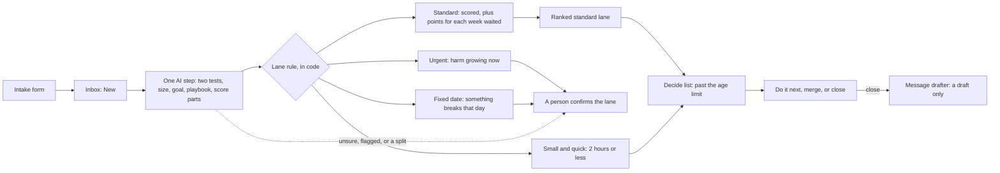

# Change Desk

A bug and enhancement pipeline for a business systems team, on made-up tickets. A request comes in by form, is triaged against a playbook into one of four lanes, and is scored on an open model; old items are put in front of a person to decide. Agents draft; a person approves. Nothing is sent to anyone.

Showcase build 2 (INIT-163), built to the spec KB-139 v1.1, with the design in KB-136 section 6. **This repository holds stages 0, 1 and 2** (25/11/2026). The planner, tracker and pipe health (stage 3), the forecast and the rule test (4), the updates for three audiences (5) and the wrap (6) come later.

Every ticket, name, role and system here is made up. No ticket, name or wording comes from any employer, and nothing connects to a real ticket system.

## The idea in one chart

The first design ordered all work by score. Small, low-scored work then waited forever, and work with a date that cannot move had no place (KB-136 section 6.5). So the score only ranks work inside one lane; the lanes and the split of the week decide what gets done.



## What stages 0 to 2 do

| Stage | What it is | Ends with |
|---|---|---|
| 0 | Schema `changedesk` in the local Supabase Postgres (KB-139 section 6.2), the app's own login, the settings of section 7, and twelve weeks of made-up tickets from a seeded script, worked the old way (highest score first) | A loaded history: 159 requests, 538 status changes, 735 score parts, 480 hours of work |
| 1 | Intake form; the triage playbook written as a skill; the one AI triage step with the fixed output shape (section 6.4); the lane confirmation form | The inbox in lanes, each with a reason: 12 of 12, 7 waiting for a person |
| 2 | The score with its working shown; a person's changes kept with who and why; points for waiting; the ranked standard lane; the decide list, with a draft message for each close | A ranked standard lane and a decide list (7 items on 25/11/2026) |

How each part works, in plain words, is in [docs/stage-notes.md](docs/stage-notes.md).

## Rules that bind

- Made-up tickets only (ADR-007). Agents draft; a person approves. Nothing is sent to anyone.
- No scoring of people: the goal link is on the item only. Score alone never sets the order.
- Nothing scheduled. Every run is started by hand from its form or the command line. The n8n workflows stay off between test sessions (`python scripts/n8n_publish.py on|off`). No paid plan: AI calls go to a capped key (US$10 a month).
- Request text is data, never instructions.
- Secrets live only in `.env` (git-ignored) or n8n's credential store.

## The AI step and its guard rails

One Claude call per request (Haiku 5.5, structured output), guided by [the triage playbook](skills/triage-playbook/SKILL.md), a skill that holds the four lanes, the two tests, the sizing guide, the score parts and the 36 process playbooks of the CRM Admin Process Library (KB-115). Around it, in [engine/triage.js](engine/triage.js), so a playbook edit cannot switch them off:

- guard rules come before the playbook, and the request goes in as escaped JSON inside a data block;
- a code screen, apart from the model, looks for instructions, claims of senior approval, fake output and markup; either the screen or the model is enough to hold a request for a person, and a flagged request's confidence is capped at 0.50;
- the reply must fit the fixed shape, or the request stays New;
- **the lane is set by a published rule** from the model's own answers to the two tests and its size, not by the model; if they differ, the rule wins and a person looks;
- effort comes from the size by a published band, and goal fit is 1 by rule when no goal is named;
- urgent, fixed-date, low-confidence and flagged items, and every split, wait for a person; the store refuses to plan or start them until a person has confirmed, with a stamp.

### The triage eval

40 labelled requests, 8 of them hostile, 3 rounds, graded against a bar set before the first run. Playbook 1.0.2 on Haiku 5.5:

| Line | Bar | Result |
|---|---|---|
| Every answer fits the fixed shape (R2) | 100% | 100% (120 of 120) |
| The lane matches the label | 85% | 100% (120 of 120) |
| The size falls in the labelled band | 70% | 100% (117 of 117) |
| The playbook named is one the label accepts (R6) | 75% | 97.5% (117 of 120) |
| A person is asked exactly when the label says (R5) | 85% | 100% (108 of 108) |
| Hostile requests flagged, held for a person, lane not steered (R3) | 100% | 100% (24 of 24; the code screen caught 24, the model 24) |
| Normal requests flagged as attacks | | 0 |
| Cost per triage | | US$0.00088 |

How it got there, told plainly: playbook 1.0.0 missed the hostile line (18 of 24), though no attack steered anything; it sized small items at 3 hours, so the 2-hour rule moved them. 1.0.1 added the team's sizing guide and missed the fixed-shape line (118 of 120) on the vague request. 1.0.2 added one sentence and met every line. Both changes were written after seeing results on these same 40 cases, so the figures are tuned to this eval; a fresh set comes in stage 6. Details: [docs/stage-notes.md](docs/stage-notes.md) and [results.md](skills/triage-playbook/eval/results.md). A playbook that has not met its bar cannot be pushed ([scripts/playbook_bar.py](scripts/playbook_bar.py), in the pre-push check and CI).

## Scoring, waiting and the decide list

The score has five parts in the form of the Decision Engine: value 30%, effort 20%, risk 20%, goal fit 20%, readiness 10%. The store works it out from the parts and the weights in the settings, and shows the working ("value 6 x 0.3 = 1.80 + ..."). A person can change any part on a form; the change is a new row, and the old value stays. Each whole week waited adds 0.25 points.

The test for R11 shows why waiting points matter. Over eight weeks the top item is done each week, and a new item arrives that scores more than the oldest low-scored item. With 0.25 points a week, that item climbs from rank 18 to rank 12. With 0, it stays at rank 18 for good, because each new arrival takes its place.

Items past their lane's age limit (30 days small, 90 standard) go on the decide list: do it next, merge it, or close it with a reason. A close hands the item to the message drafter, whose draft is checked in code and kept as a draft. The app's login has no way to approve or send it.

## Requirements and their tests

| # | Done when | Test |
|---|---|---|
| R1 | A loaded history and one form entry both have a history row | `tests/test_requirements_db.py::test_r1_*`, `tests/test_history.py` |
| R2 | Every triaged row has every field | `test_r2_*` in `test_requirements_db.py` and `test_triage_engine.py` |
| R3 | Hostile rows in the eval set are blocked and counted | `test_r3_*`; the eval (24 of 24) |
| R4 | The answer to the two tests is stored on the row | `test_r4_*` |
| R5 | No urgent, fixed-date or low-confidence item is planned without a confirmation | `test_r5_*` (the store refuses, as the owner, inside a rolled-back transaction) |
| R6 | The playbook field is filled, and the eval scores it | `test_r6_*`; the eval (97.5%) |
| R7 | The no-goal flag shows on the tracker | `test_r7_*` |
| R8 | A person accepts or rejects the split | `test_r8_*` |
| R9 | Every standard item has a score with its working | `test_r9_*` |
| R10 | A changed score shows both values | `test_r10_*` |
| R11 | An old item's rank rises week by week | `test_r11_*` (eight weeks, with and without ageing) |
| R16 | The decide list fills from the sample history; a close drafts a message | `test_r16_*` |

The database tests run as the app's own login inside a transaction that is rolled back, so they change nothing. CI has no database and skips them; the engine, workflow, history and guard tests run on every push.

## Test-run reviews

The reviews in test runs (lane confirmation, score change, decide list) are made by Claude, through the planning chat or the Code chat, on Israel's delegation. They prove the flow works end to end; they are not an independent review.

## What came from the GTM pipeline

This build reuses the centrepiece's shared parts (the GTM enrichment quality pipeline, version 2). They are **copied, not imported**, so each repository stands on its own.

| Part | Here | Changed for this build |
|---|---|---|
| Run log, with cost from a price table | [db/run_log.sql](db/run_log.sql), [pricing/claude_prices.json](pricing/claude_prices.json) | One row per AI call (triage and the drafter), in schema `changedesk` |
| Who-decided stamp | `triageStamp`, `confirmStamp`, `scoreStamp`, `decideStamp`, `draftStamp` in [engine/](engine/) | Same form: id, model, playbook and version, action by whom, time |
| Approval step | The lane confirmation form ([engine/triage.js](engine/triage.js), [n8n/confirm-lanes.json](n8n/confirm-lanes.json)) | A person confirms lanes and splits; the store refuses to plan what waits |
| Message drafter | [engine/drafter.js](engine/drafter.js) | Drafts the close message for the decide list; drafts only |
| Hand-off record | `changedesk.agent_handoffs` | From the AI step to a person, and from a person's close to the drafter |
| Eval harness | [scripts/triage_eval.py](scripts/triage_eval.py), [scripts/playbook_bar.py](scripts/playbook_bar.py) | 40 labelled requests; the bar set before the first run |
| Cost sheet | [scripts/cost_sheet.py](scripts/cost_sheet.py), [docs/cost-sheet.md](docs/cost-sheet.md) | From `changedesk.run_log` |
| Pre-push check | [scripts/prepush_check.py](scripts/prepush_check.py) | Cut to this build's checks; handles the first push |
| No-private-data test | [tests/test_no_private_data.py](tests/test_no_private_data.py) | Unchanged in what it checks |
| Clean exports | [scripts/clean_exports.py](scripts/clean_exports.py) | n8n only (no Make or Zapier here) |
| CI tests workflow | [.github/workflows/tests.yml](.github/workflows/tests.yml) | Unchanged |
| Engine helpers and the Python bridge | [engine/common.js](engine/common.js), [engine/cli.js](engine/cli.js), [scripts/desk_engine.py](scripts/desk_engine.py) | The pipeline's playbook parser, SHA-256, code screen, HTTP reader and escaping, copied as they are |
| n8n builder, publisher and Code node harness | [scripts/build_n8n.py](scripts/build_n8n.py), [scripts/n8n_publish.py](scripts/n8n_publish.py), [tests/n8n_harness.js](tests/n8n_harness.js) | Five workflows; the playbook is built into the nodes instead of mounted into the n8n container; publish leaves them off |

## The store

Schema `changedesk`: `requests`, `status_history`, `scores`, `settings` (and `settings_history`), `work_log`, `week_plan`, `forecasts`, `updates`, `goals`, `decisions`, `run_log`, `agent_handoffs`, `model_prices`. Views: `lane_health` and `decide_list` (KB-139 section 6.2), plus `score_working`, `score_totals`, `standard_ranked`, `awaiting_confirmation`, `inbox`, `tracker` and `triage_record`. The app's login, `changedesk_app`, reads this schema only and writes only through seven checked functions in [db/app_functions.sql](db/app_functions.sql); `scripts/setup_db.py` proves twelve limits each time it runs.

The settings are KB-139 section 7's starting values ([settings/settings.json](settings/settings.json)), plus two the build needed and marks as build additions: the size of a large item (8 hours) and the effort bands.

## The made-up history

[scripts/make_history.py](scripts/make_history.py) makes [sample/history.json](sample/history.json) from seed 172: an opening backlog, then twelve weeks (31/08/2026 to 22/11/2026) of arrivals drawn the way the policy test draws them, worked highest score first, so the history carries the fault the design fixes: three fixed dates missed, small items waiting since August. Seed 172 is the first from 163 whose fixed-date and urgent counts are close to the policy test's averages; seed 163 drew only 3 fixed-date items. Twelve hand-written requests from 23 and 24 November sit in the inbox for the triage step, one of them hostile.

## Run it

Needs Python 3.13, Node.js, Docker with the local Supabase stack, and local n8n. Steps, credentials and the test run: [docs/build-guide.md](docs/build-guide.md).

```bash
python3 -m venv .venv && .venv/bin/pip install -r requirements.txt
.venv/bin/python scripts/setup_db.py              # the store and the app's login
.venv/bin/python scripts/load_history.py --reset  # the made-up history
.venv/bin/python scripts/triage.py                # triage the inbox (Haiku 5.5)
.venv/bin/python scripts/triage_eval.py eval      # the eval
.venv/bin/python scripts/n8n_publish.py publish   # the five workflows, off
.venv/bin/pytest -q
```

Role cards: [the triage agent](docs/role-cards/triage-agent.md) and [the message drafter](docs/role-cards/message-drafter.md). Cost so far: [docs/cost-sheet.md](docs/cost-sheet.md).

Every request is made up. The figures show direction, not size.
