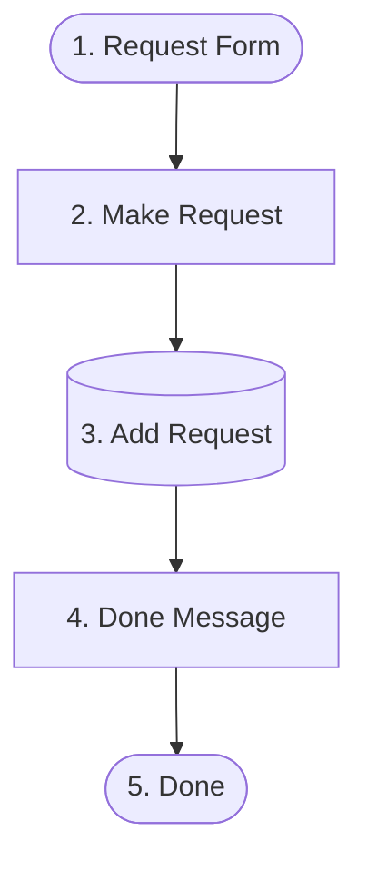
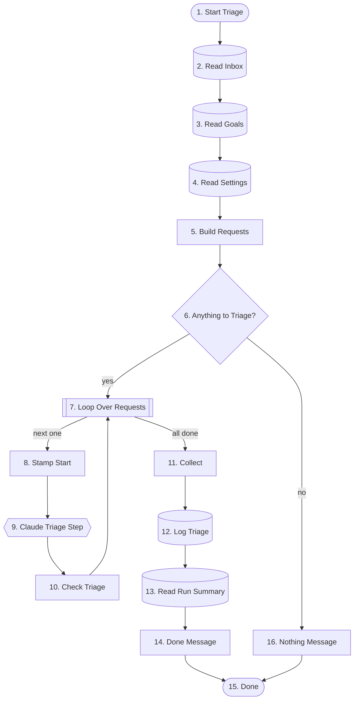
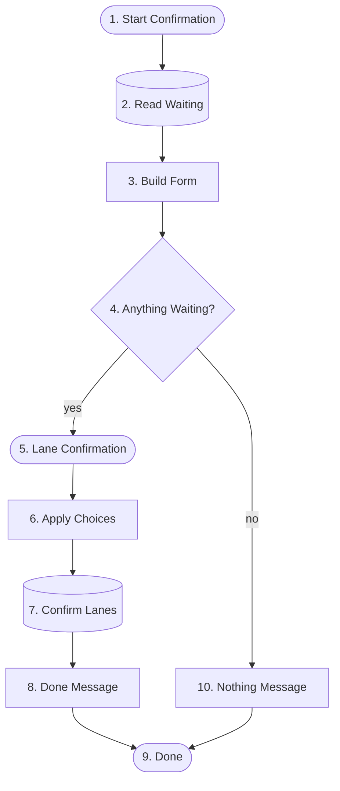
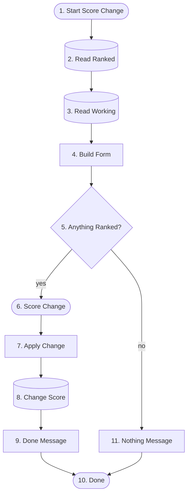
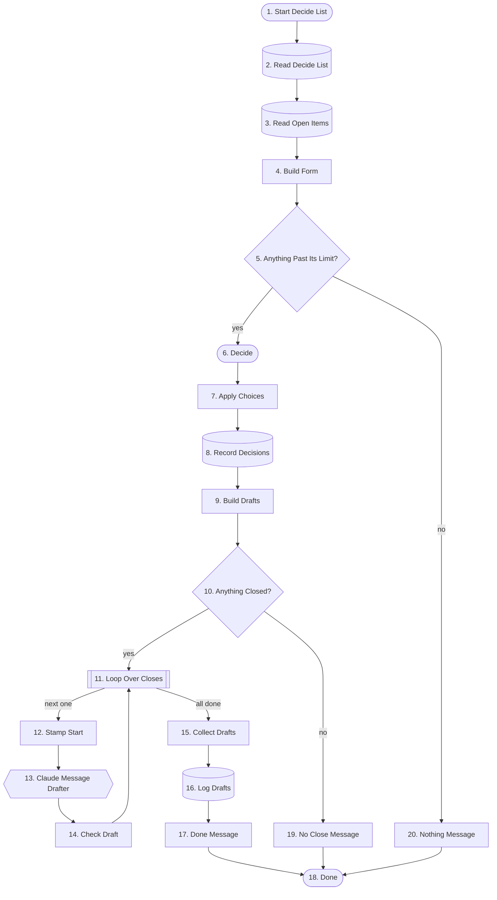
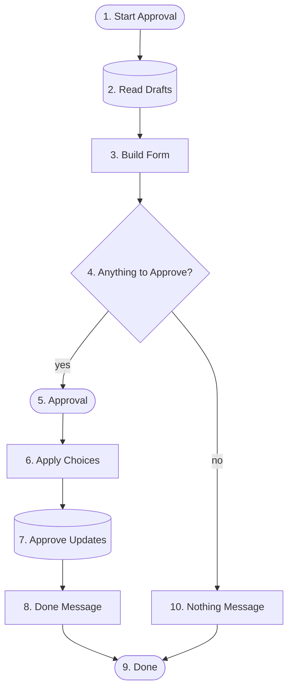

# The workflows, drawn from their files

Made by `scripts/build_docs.py` from `n8n/*.json` (the files `scripts/build_n8n.py` writes and `scripts/n8n_publish.py` puts into n8n). Each diagram's numbers are its step list's numbers. Every workflow starts from a form, by hand: none has a schedule. Every write goes through one of the store's checked functions. Nothing sends: an approved update goes to the outbox table only. `tests/test_build_docs.py` fails if this page differs from the files.

## Change Desk: intake form

File `n8n/intake.json`; form `/form/changedesk-intake`; 5 nodes; 0 AI steps; writes through `add_request`.

1. **Request Form** (form, started by hand): Change Desk: ask for a change
2. **Make Request** (code): The form's answers, as the store's add_request function takes them. The text is data: nothing here reads it as instructions.
3. **Add Request** (store): writes through add_request
4. **Done Message** (code): the words of the closing message
5. **Done** (form page): the closing message

## Change Desk: run triage

File `n8n/triage.json`; form `/form/changedesk-triage`; 16 nodes; 1 AI step; writes through `log_triage`.

1. **Start Triage** (form, started by hand): Change Desk: run triage
2. **Read Inbox** (store): reads inbox
3. **Read Goals** (store): reads goals
4. **Read Settings** (store): reads settings
5. **Build Requests** (code): One Claude request per request in the inbox. The text goes inside a data block, after the guard rules.
6. **Anything to Triage?** (check)
7. **Loop Over Requests** (one at a time)
8. **Stamp Start** (code): notes when the AI call starts
9. **Claude Triage Step** (Claude API, the one AI step): one Messages call, Haiku 5.5, structured output
10. **Check Triage** (code): The guard rails: the fixed shape, the lane rule, the confidence bar, the split, the code screen, the stamp.
11. **Collect** (code): the engine's `triageHandoff`, `summariseTriage`
12. **Log Triage** (store): writes through log_triage
13. **Read Run Summary** (store): reads run_summary
14. **Done Message** (code): the words of the closing message
15. **Done** (form page): the closing message
16. **Nothing Message** (code): the words of the closing message

## Change Desk: confirm lanes

File `n8n/confirm-lanes.json`; form `/form/changedesk-confirm-lanes`; 10 nodes; 0 AI steps; writes through `confirm_lanes`.

1. **Start Confirmation** (form, started by hand): Change Desk: confirm lanes
2. **Read Waiting** (store): reads awaiting_confirmation
3. **Build Form** (code): the engine's `buildConfirmForm`
4. **Anything Waiting?** (check)
5. **Lane Confirmation** (form page): Confirm the lanes
6. **Apply Choices** (code): the engine's `applyConfirmations`
7. **Confirm Lanes** (store): writes through confirm_lanes
8. **Done Message** (code): the words of the closing message
9. **Done** (form page): the closing message
10. **Nothing Message** (code): the words of the closing message

## Change Desk: change a score

File `n8n/change-score.json`; form `/form/changedesk-change-score`; 11 nodes; 0 AI steps; writes through `change_score`.

1. **Start Score Change** (form, started by hand): Change Desk: change a score
2. **Read Ranked** (store): reads standard_ranked
3. **Read Working** (store): reads score_working, standard_ranked
4. **Build Form** (code): the engine's `buildScoreForm`
5. **Anything Ranked?** (check)
6. **Score Change** (form page): Change one part of a score
7. **Apply Change** (code): the engine's `applyScoreChange`
8. **Change Score** (store): writes through change_score
9. **Done Message** (code): the words of the closing message
10. **Done** (form page): the closing message
11. **Nothing Message** (code): the words of the closing message

## Change Desk: decide list

File `n8n/decide.json`; form `/form/changedesk-decide`; 20 nodes; 1 AI step; writes through `decide`, `log_drafts`.

1. **Start Decide List** (form, started by hand): Change Desk: decide list
2. **Read Decide List** (store): reads decide_list
3. **Read Open Items** (store): reads requests
4. **Build Form** (code): the engine's `buildDecideForm`
5. **Anything Past Its Limit?** (check)
6. **Decide** (form page): Decide the old items
7. **Apply Choices** (code): the engine's `applyDecideChoices`
8. **Record Decisions** (store): writes through decide
9. **Build Drafts** (code): One message draft per closed item. The drafter sees the title, the role and the reason: no score, no request text.
10. **Anything Closed?** (check)
11. **Loop Over Closes** (one at a time)
12. **Stamp Start** (code): notes when the AI call starts
13. **Claude Message Drafter** (Claude API, the one AI step): one Messages call, Haiku 5.5, structured output
14. **Check Draft** (code): The draft is checked in code before anyone sees it: the request id is named, no internal codes, no promise, no contact details.
15. **Collect Drafts** (code)
16. **Log Drafts** (store): writes through log_drafts
17. **Done Message** (code): the words of the closing message
18. **Done** (form page): the closing message
19. **No Close Message** (code): the words of the closing message
20. **Nothing Message** (code): the words of the closing message

## Change Desk: approve updates

File `n8n/approve-updates.json`; form `/form/changedesk-approve-updates`; 10 nodes; 0 AI steps; writes through `approve_updates`.

1. **Start Approval** (form, started by hand): Change Desk: approve updates
2. **Read Drafts** (store): reads stale_facts, updates, requests
3. **Build Form** (code): Drafts with a problem from the code check, or whose facts no longer match their rows, can only be rejected.
4. **Anything to Approve?** (check)
5. **Approval** (form page): Approve the updates
6. **Apply Choices** (code): the engine's `applyApprovals`
7. **Approve Updates** (store): writes through approve_updates
8. **Done Message** (code): the words of the closing message
9. **Done** (form page): the closing message
10. **Nothing Message** (code): the words of the closing message
